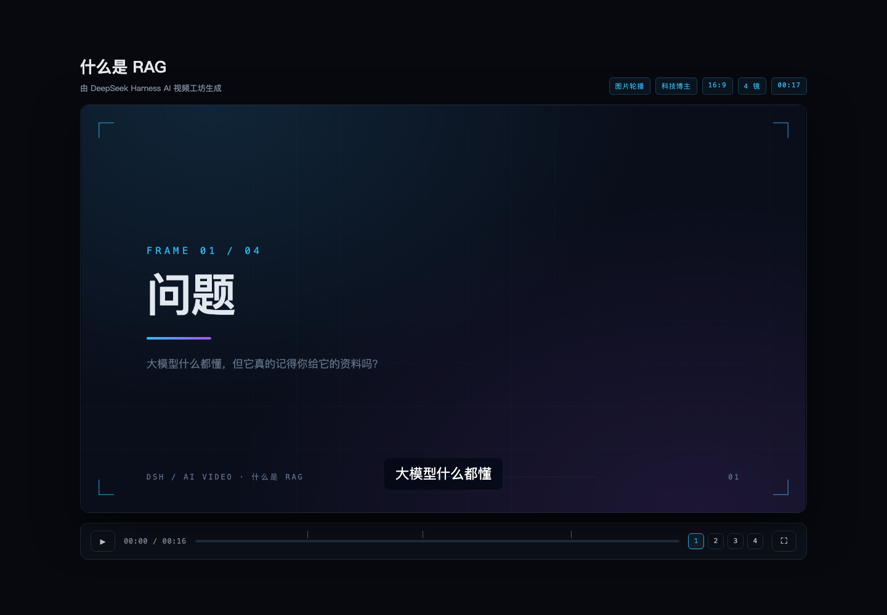
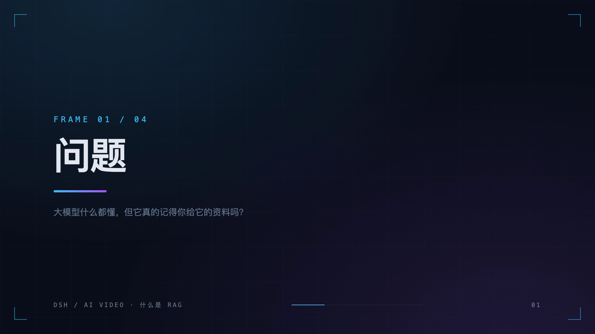
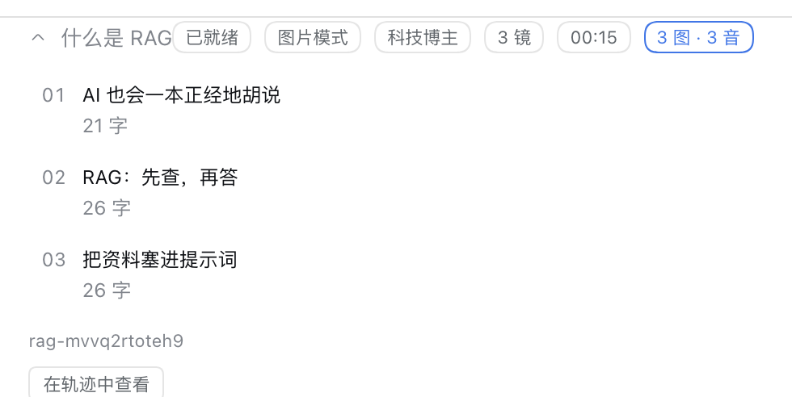

# DeepSeek Harness AI Video Studio

English | [中文](README.md)

`dsh-plugin-ai-video` brings a complete "one sentence → explainer video" pipeline to [DeepSeek Harness](https://github.com/deepseek-ai/deepseek-harness). The agent writes the outline, per-frame narration, image prompts or HTML animation; the plugin persists the project, generates narration and stills, builds subtitles and an offline preview player, and renders an MP4 with ffmpeg.

The product shape and the three visual styles are inspired by [xuanyuanzhifeng/ai-video-agent](https://github.com/xuanyuanzhifeng/ai-video-agent). This project is an independent implementation rebuilt for the DSH 0.2 plugin system: no Next.js, no database, no front-end build — one installable plugin package.

[](https://github.com/flynow-harness/dsh-plugin-ai-video/actions/workflows/ci.yml)

## Preview

The generated preview player is fully offline: open `preview.html` and play — frames, narration and captions stay in sync, with keyboard and fullscreen controls.



Stills come from a configured image gateway or, with no account at all, from the built-in title cards:



Every tool call renders a storyboard card in the conversation; expand it to see each frame's title, character count, image/audio readiness and duration:



## What it does

| Role | Responsibility |
| --- | --- |
| Agent | Writes the outline, narration and image prompts; in `html` mode it writes the HTML/CSS/JS animation itself |
| Plugin | Project persistence, TTS, image generation, timing, subtitle segmentation, preview player, ffmpeg MP4 |

- **Two modes**: `image` (one still per frame) and `html` (one web animation per frame)
- **Three styles**: `cyber-clean` (科技博主), `terminal-matrix` (黑客风), `warm-story` (暖色系)
- **Three aspect ratios**: `16:9`, `9:16`, `1:1`
- **Incremental edits**: `video_edit_frames` supports update / insert / remove / move; a changed narration clears its stale audio and a changed visual clears its stale still
- **Works without an account**: headless Chrome renders the built-in title card as a still, macOS `say` / Linux `espeak-ng` provides narration; configure a gateway and the plugin switches to it automatically
- **One subtitle source**: `.srt`, `.vtt` and the preview caption layer are generated from the same cues
- **MP4 export**: H.264 + AAC, burning subtitles when the local ffmpeg has libass
- **Files are the database**: a readable `project.json` plus one directory per project

## Compatibility

| Plugin | DSH |
| --- | --- |
| `0.1.x` | `dsh@0.2.2-alpha.2` |

DSH is in preview and its client interfaces move between releases. Install the plugin build that matches your DSH version.

## Install

### From a local `.tgz` (recommended)

```sh
npx --yes @deepseek-ai/dsh@0.2.2-alpha.2 plugin \
  --profile web \
  add ./dsh-plugin-ai-video-0.1.0.tgz
```

Verify, then restart the Web UI:

```sh
npx --yes @deepseek-ai/dsh@0.2.2-alpha.2 plugin --profile web list --depth 0
dsh web
```

### From source

```sh
git clone https://github.com/flynow-harness/dsh-plugin-ai-video.git
cd dsh-plugin-ai-video
pnpm install
pnpm pack
dsh plugin --profile web add ./dsh-plugin-ai-video-0.1.0.tgz
```

### From GitHub

```sh
dsh plugin --profile web add github:flynow-harness/dsh-plugin-ai-video
```

pnpm 11 refuses to run a git dependency's build script by default (`ERR_PNPM_GIT_DEP_PREPARE_NOT_ALLOWED`). Allow it only if you trust the source:

```yaml
# pnpm-workspace.yaml in the profile
allowBuilds:
  dsh-plugin-ai-video: true
```

### Uninstall

```sh
dsh plugin --profile web remove dsh-plugin-ai-video
```

## Configuration

Every key has a default; the plugin is usable with no configuration. Put secrets in environment variables and structured settings in the profile patch.

### Environment variables

| Variable | Purpose |
| --- | --- |
| `DSH_VIDEO_ROOT` | Project root, default `$DSH_HOME/ai-video` |
| `DSH_VIDEO_IMAGE_BASE_URL` / `DSH_VIDEO_IMAGE_API_KEY` | OpenAI-compatible image gateway |
| `DSH_VIDEO_TTS_BASE_URL` / `DSH_VIDEO_TTS_API_KEY` | OpenAI-compatible speech gateway |
| `DSH_VIDEO_FFMPEG` / `DSH_VIDEO_FFPROBE` | Custom ffmpeg / ffprobe binaries |
| `DSH_VIDEO_CHROME` | Custom Chrome / Chromium binary |

### Profile patch

```yaml
# $DSH_HOME/profiles/<name>/cordis.patch.yml
- id: ai-video
  config:
    imageBaseUrl: https://api.openai.com/v1
    imageModel: gpt-image-1
    ttsBaseUrl: https://api.openai.com/v1
    ttsModel: gpt-4o-mini-tts
    ttsVoice: alloy
```

| Key | Default | Meaning |
| --- | --- | --- |
| `rootDir` | `$DSH_HOME/ai-video` | Project root |
| `ffmpegPath` / `ffprobePath` | `ffmpeg` / `ffprobe` | External binaries |
| `chromePath` | auto-detected | Chrome / Chromium |
| `browserRender` | `true` | Allow HTML → PNG rendering |
| `autoVisuals` | `true` | Fill missing stills with the title card |
| `localTts` | `true` | Use the OS speech synthesizer when no gateway is configured |
| `imageBaseUrl` / `imageApiKey` | empty | Image gateway |
| `imageModel` / `imageSize` | `gpt-image-1` / `1536x1024` | Image request |
| `ttsBaseUrl` / `ttsApiKey` | empty | Speech gateway |
| `ttsModel` / `ttsVoice` | `gpt-4o-mini-tts` / `alloy` | Speech request |
| `localVoice` | empty | `say` voice, e.g. `Tingting` |
| `fps` / `width` / `height` | `30` / `1920` / `1080` | Output geometry |
| `crf` | `20` | x264 quality |
| `burnSubtitles` | `true` | Burn in when libass exists |
| `frameTailSec` | `0.35` | Silence after each narration |

## Usage

Describe the video in chat; the agent drives the tools:

```text
Make a 30-second explainer about RAG, cyber-clean style, vertical.
Change frame 3 to a data visualisation, no people.
Rewrite frame 2's narration to sound more conversational and regenerate its audio.
Delete the last frame, add a closing frame, then export the MP4.
```

| Tool | Purpose |
| --- | --- |
| `video_create` | Create a project (title, mode, style, aspect) |
| `video_outline` | Write or replace the whole storyboard |
| `video_edit_frames` | Local edits: `update` / `insert` / `remove` / `move` |
| `video_generate` | Generate stills and narration, optionally for selected frames |
| `video_preview` | Write subtitles and the offline player (no encode) |
| `video_render` | Export the MP4 and refresh preview + subtitles |
| `video_show` | Inspect project, timeline, cues and deliverable paths |
| `video_list` | List every project on this machine |

## Output layout

```text
~/.dsh/ai-video/<project-id>/
├── project.json            # project + frames, plain text
├── preview.html            # offline player
├── assets/
│   ├── f1.png              # still (gateway or title card)
│   └── f1.m4a              # narration
└── out/
    ├── <project-id>.mp4
    ├── subtitles.srt
    ├── subtitles.vtt
    └── filtergraph.txt     # the ffmpeg graph that ran
```

## Requirements

| Dependency | Required | Notes |
| --- | --- | --- |
| Node.js 22.19+ / 24+ | yes | same as DSH |
| `ffmpeg` + `ffprobe` | for MP4 export | preview and subtitles do not need it |
| Chrome / Chromium | optional | title cards and `html` mode frames; falls back to a solid slide |
| TTS gateway or `say` / `espeak-ng` | optional | without either, the video is silent but still subtitled |
| Image gateway | optional | without one, stills use the built-in title card |

```sh
brew install ffmpeg   # macOS
```

## Design notes

- **No database.** A project is a directory and `project.json` is the single source of truth; both the agent and a human can read and edit it.
- **Timeline first.** Frame duration = explicit `durationSec` → measured narration + tail → narration estimate. You can preview and export before any audio exists.
- **Subtitles from one source.** Narration is split at punctuation, timed by character weight, short cues merge and long ones split; `.srt`, `.vtt` and the player share the same cues.
- **Pay only on demand.** The image gateway is called only when it is configured and a frame has a `visual`; title cards, subtitles and preview are local.
- **Resumable generation.** `video_generate` saves each frame as it finishes, reports failures individually, and accepts `frameIds` to retry only those.

## Known limitations

- `html` mode exports one representative still per frame (around 1.5 s) to MP4; `preview.html` keeps the full animation. Use `image` mode when every frame must be a moving picture.
- Subtitle burn-in needs ffmpeg's `subtitles` filter (libass). Homebrew's stock `ffmpeg` omits it; the `.srt`/`.vtt` still ship beside the video and the preview always shows captions.
- Image gateways must speak OpenAI `POST /images/generations` (`b64_json` or `url`) and, for task-style APIs, `GET /tasks/{id}`.
- Projects default to `$DSH_HOME/ai-video` and do not follow the workspace.

## Development

```sh
pnpm install
pnpm typecheck
pnpm test        # unit tests plus end-to-end tests when the toolchain exists
pnpm build
pnpm pack
```

The integration suite probes for ffmpeg, Chrome and a system voice, skipping itself when one is missing, so CI stays green on a minimal runner.

Run the whole pipeline without a chat session:

```sh
pnpm build
node examples/make-demo.mjs "什么是 RAG" ./demo-output
```

## Acknowledgements

- Product shape, the three styles and the outline → storyboard → narration → subtitles → export workflow come from [xuanyuanzhifeng/ai-video-agent](https://github.com/xuanyuanzhifeng/ai-video-agent).
- The package skeleton, build setup and Web tool-card registration follow [dsh-plugin-agent-workflow](https://github.com/flynow-harness/dsh-plugin-agent-workflow).

## License

[MIT](LICENSE)
