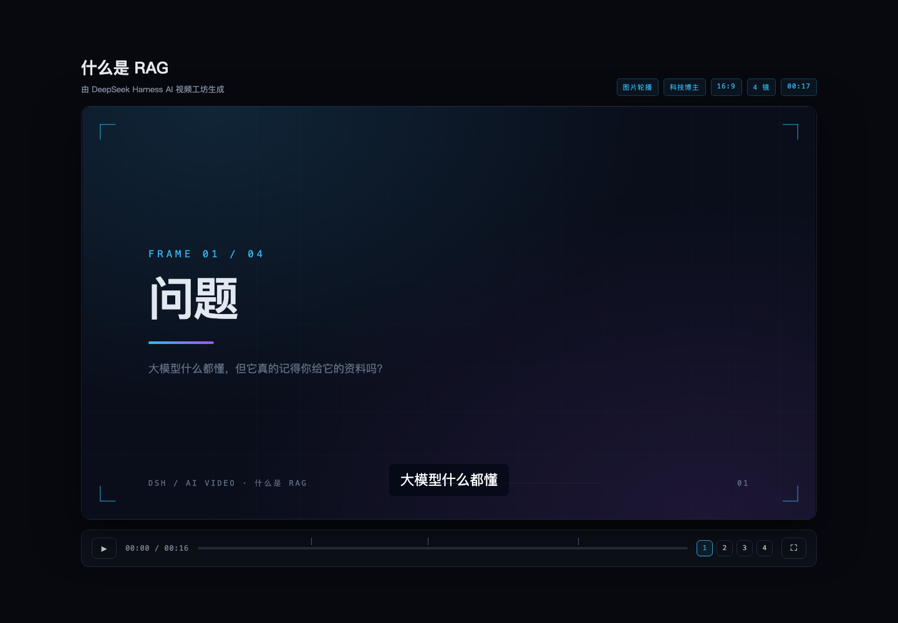
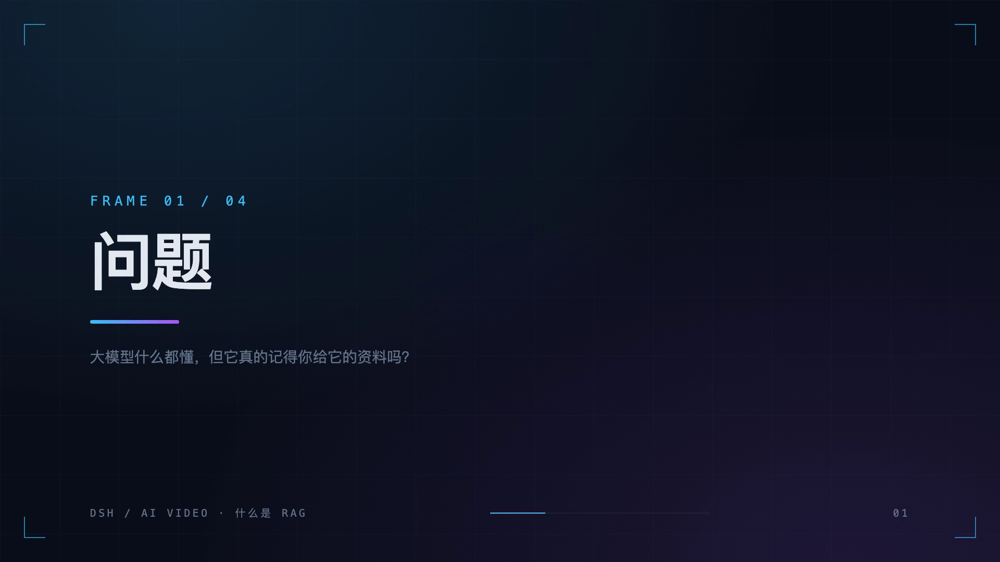

# DeepSeek Harness AI 视频工坊

[English](README.en.md) | 中文

`dsh-plugin-ai-video` 把「一句话生成讲解视频」的完整流水线装进 DeepSeek Harness：Agent 负责写分镜、旁白、画面提示词或 HTML 动画，插件负责落盘、生成配音与图像、切字幕、生成浏览器预览播放器，最后用 ffmpeg 导出 MP4。

产品形态与三种视觉风格参考了 [xuanyuanzhifeng/ai-video-agent](https://github.com/xuanyuanzhifeng/ai-video-agent)，本项目是针对 DSH 0.2 插件体系重写的独立实现：没有 Next.js、没有数据库、没有前端构建，安装一个插件包即可使用。

[](https://github.com/flynow-harness/dsh-plugin-ai-video/actions/workflows/ci.yml)

## 界面预览

预览播放器由插件生成，双击 `preview.html` 即可离线播放：分镜、配音、字幕同步，支持键盘空格/方向键与全屏。



分镜画面来自内置标题卡（无需图片 API）或你配置的图像网关：



每次工具调用在对话里渲染成一张分镜卡片，展开即可看到每镜的标题、字数、图片/配音就绪状态和时长：


## 它做什么

| 角色 | 职责 |
| --- | --- |
| Agent | 写视频大纲、每镜旁白、图像提示词；`html` 模式下直接写 HTML/CSS/JS 动画 |
| 插件 | 项目持久化、TTS 配音、图像生成、时间轴、字幕切片、预览播放器、ffmpeg 合成 MP4 |

内置能力：

- **两种模式**：`image`（每镜一张图）与 `html`（每镜一段网页动画）
- **三种风格**：科技博主 `cyber-clean`、黑客风 `terminal-matrix`、暖色系 `warm-story`
- **九种画幅**：`16:9`、`9:16`、`1:1`（1920×1080 / 1080×1920 / 1080×1080）
- **增量改稿**：`video_edit_frames` 支持 update / insert / remove / move，改旁白自动清理过期配音，改画面自动清理过期图片
- **无 API 也能跑**：Chrome 渲染内置标题卡当分镜，macOS `say` / Linux `espeak-ng` 当配音；配置网关后自动切换为正式服务
- **字幕三件套**：同一份时间轴生成 `.srt`、`.vtt` 和预览播放器字幕层
- **MP4 导出**：H.264 + AAC，本地 ffmpeg 带 libass 时自动烧录字幕
- **文件即项目**：`project.json` 可读、可 diff、可手动修，所有产物都在一个目录里

## 兼容版本

| 插件版本 | DSH 版本 |
| --- | --- |
| `0.1.x` | `dsh@0.2.2-alpha.2` |

DSH 仍处于预览阶段，客户端接口会随版本变化。升级 DSH 后请同时安装对应版本的插件。

## 安装

### 安装本地 `.tgz`（推荐）

```sh
npx --yes @deepseek-ai/dsh@0.2.2-alpha.2 plugin \
  --profile web \
  add ./dsh-plugin-ai-video-0.1.0.tgz
```

确认安装结果：

```sh
npx --yes @deepseek-ai/dsh@0.2.2-alpha.2 plugin --profile web list --depth 0
```

重启 DSH Web（`dsh web` 或 `pnpm dsh web`）后，对话里就能看到视频工具调用卡片。

### 从源码构建安装

```sh
git clone https://github.com/flynow-harness/dsh-plugin-ai-video.git
cd dsh-plugin-ai-video
pnpm install
pnpm pack
```

把生成的 `dsh-plugin-ai-video-0.1.0.tgz` 安装到目标 profile：

```sh
dsh plugin --profile web add ./dsh-plugin-ai-video-0.1.0.tgz
```

### 从 GitHub 直接安装

```sh
dsh plugin --profile web add github:flynow-harness/dsh-plugin-ai-video
```

pnpm 11 默认禁止 Git 依赖执行构建脚本（`ERR_PNPM_GIT_DEP_PREPARE_NOT_ALLOWED`），首次安装会失败。只有在你信任源码时，才按提示在 profile 的 `pnpm-workspace.yaml` 里放行：

```yaml
allowBuilds:
  dsh-plugin-ai-video: true
```

### 卸载

```sh
dsh plugin --profile web remove dsh-plugin-ai-video
```

## 配置

所有配置都有默认值，不配置也能用（内置标题卡 + 系统语音）。推荐用环境变量放密钥，用 profile patch 放结构化配置。

### 环境变量

| 变量 | 说明 |
| --- | --- |
| `DSH_VIDEO_ROOT` | 项目根目录，默认 `$DSH_HOME/ai-video` |
| `DSH_VIDEO_IMAGE_BASE_URL` | OpenAI 兼容图像网关地址（代码自动补 `/v1`） |
| `DSH_VIDEO_IMAGE_API_KEY` | 图像网关密钥 |
| `DSH_VIDEO_TTS_BASE_URL` | OpenAI 兼容语音网关地址（代码自动补 `/v1`） |
| `DSH_VIDEO_TTS_API_KEY` | 语音网关密钥 |
| `DSH_VIDEO_FFMPEG` / `DSH_VIDEO_FFPROBE` | 自定义 ffmpeg / ffprobe 可执行文件 |
| `DSH_VIDEO_CHROME` | 自定义 Chrome / Chromium 可执行文件 |

### Profile patch

编辑 `$DSH_HOME/profiles/<name>/cordis.patch.yml`：

```yaml
- id: ai-video
  config:
    imageBaseUrl: https://api.openai.com/v1
    imageModel: gpt-image-1
    imageSize: 1536x1024
    ttsBaseUrl: https://api.openai.com/v1
    ttsModel: gpt-4o-mini-tts
    ttsVoice: alloy
```

完整配置项：

| 键 | 默认值 | 说明 |
| --- | --- | --- |
| `rootDir` | `$DSH_HOME/ai-video` | 项目根目录 |
| `ffmpegPath` / `ffprobePath` | `ffmpeg` / `ffprobe` | 外部可执行文件 |
| `chromePath` | 自动探测 | Chrome / Chromium 路径 |
| `browserRender` | `true` | 允许 HTML → PNG 渲染 |
| `autoVisuals` | `true` | 缺图时用内置标题卡补图 |
| `localTts` | `true` | 无 TTS 网关时使用系统语音 |
| `imageBaseUrl` / `imageApiKey` | 空 | OpenAI 兼容图像网关 |
| `imageModel` | `gpt-image-1` | 图像模型名 |
| `imageSize` | `1536x1024` | 请求尺寸 |
| `ttsBaseUrl` / `ttsApiKey` | 空 | OpenAI 兼容语音网关 |
| `ttsModel` | `gpt-4o-mini-tts` | 语音模型名 |
| `ttsVoice` | `alloy` | 音色 |
| `localVoice` | 空 | `say` 的发音人（如 `Tingting`） |
| `fps` / `width` / `height` | `30` / `1920` / `1080` | 输出参数 |
| `crf` | `20` | x264 画质 |
| `burnSubtitles` | `true` | 本地 ffmpeg 支持 libass 时烧录字幕 |
| `frameTailSec` | `0.35` | 每镜旁白后的静音尾巴 |

## 使用

装好插件后直接用自然语言描述视频，Agent 会自己完成分镜和导出：

```text
帮我做一个 30 秒的「什么是 RAG」讲解视频，科技博主风格，竖屏
把第 3 镜改成数据可视化，不要人物
给第 2 镜换一句更口语化的旁白，重新生成配音
把最后一镜删掉，再补一个总结镜头，然后导出 MP4
```

### 工具

| 工具 | 作用 |
| --- | --- |
| `video_create` | 创建项目（标题、模式、风格、画幅） |
| `video_outline` | 写入或替换整份分镜 |
| `video_edit_frames` | 局部改稿：`update` / `insert` / `remove` / `move` |
| `video_generate` | 生成图片与配音，可只重跑指定分镜 |
| `video_preview` | 生成字幕与离线预览播放器（不编码） |
| `video_render` | 导出 MP4，并刷新预览与字幕 |
| `video_show` | 查看项目、分镜、时间轴、字幕和产物路径 |
| `video_list` | 列出本机所有视频项目 |

Web 端每次调用都会渲染成一张分镜卡片：模式、风格、时长、每镜图片/配音是否就绪，一眼可见。

## 产物结构

```text
~/.dsh/ai-video/<project-id>/
├── project.json            # 项目与分镜，纯文本
├── preview.html            # 离线预览播放器
├── assets/
│   ├── f1.png              # 分镜图（API / Chrome 标题卡）
│   └── f1.m4a              # 旁白
└── out/
    ├── <project-id>.mp4    # 成片
    ├── subtitles.srt
    ├── subtitles.vtt
    └── filtergraph.txt     # 实际使用的 ffmpeg 滤镜图
```

## 依赖

| 依赖 | 必需 | 说明 |
| --- | --- | --- |
| Node.js 22.19+ / 24+ | 是 | 与 DSH 一致 |
| `ffmpeg` + `ffprobe` | 是（导出 MP4） | 预览和字幕不需要 |
| Chrome / Chromium | 否 | 内置标题卡与 `html` 模式截图；缺失时自动退回纯色底 |
| TTS 网关 / `say` / `espeak-ng` | 否 | 都没有时导出无声视频，字幕仍可用 |
| 图像网关 | 否 | 没有时使用内置标题卡 |

macOS 上一键补齐：

```sh
brew install ffmpeg
```

## 设计说明

- **不做数据库**：一个项目就是一个目录，`project.json` 是唯一事实来源，Agent 和人都能直接读改。
- **时间轴优先**：每镜时长 = 显式 `durationSec` → 实测配音 + 尾巴 → 旁白字数估算。没有配音也能先预览、先导出。
- **字幕同源**：按标点切片，按字数分配时间，过短的 cue 合并、过长的句子再切，`.srt`、`.vtt`、播放器字幕共用同一份数据。
- **按需付费**：只有配置了网关并且分镜有 `visual` 时才调用图像 API；标题卡、字幕、预览全部本地完成。
- **失败可续**：`video_generate` 逐镜保存，失败的镜头单独列出，可用 `frameIds` 只重跑失败的。

## 已知限制

- `html` 模式导出 MP4 时，每镜取一张代表帧（约 1.5s 处）；`preview.html` 保留完整动画。需要逐帧动画成片时，建议用 `image` 模式或后续版本。
- 烧录字幕依赖 ffmpeg 的 `subtitles` 滤镜（libass）。Homebrew 官方 `ffmpeg` 未内置，此时字幕以 `.srt`/`.vtt` 外挂输出，预览播放器仍显示字幕。
- 图像网关需兼容 OpenAI `POST /images/generations`（`b64_json` 或 `url`），并兼容任务式 `GET /tasks/{id}` 轮询。
- 项目目录默认在 `$DSH_HOME/ai-video`，不随工作区移动。

## 开发

```sh
pnpm install
pnpm typecheck   # tsc --noEmit
pnpm test        # 单元测试 + 可用工具链时的端到端测试
pnpm build       # lib/index.js + lib/client.js + 类型声明
pnpm pack        # 生成可安装的 .tgz
```

集成测试会自动探测 ffmpeg / Chrome / 系统语音，缺失时跳过，因此在 CI 上也能通过。

本地试跑一遍完整流水线（不经过对话）：

```sh
pnpm build
node examples/make-demo.mjs "什么是 RAG" ./demo-output
```

## 致谢

- 产品形态、三种风格与「大纲 → 分镜 → 配音 → 字幕 → 导出」的工作流来自 [xuanyuanzhifeng/ai-video-agent](https://github.com/xuanyuanzhifeng/ai-video-agent)。
- 插件骨架、构建与 Web 卡片注册方式参考了同作者的 [dsh-plugin-agent-workflow](https://github.com/flynow-harness/dsh-plugin-agent-workflow)。

## License

[MIT](LICENSE)
